<div align="center">

# 🔍 TruthLens

### AI-Based Image & Video Authenticity Verification, Deepfake Detection and Intelligent Content Restoration

**Upload an image or a video → get an explainable verdict (authentic · manipulated · deepfake · AI-generated),
the visual evidence behind it, an optional AI restoration and a forensic PDF report.**


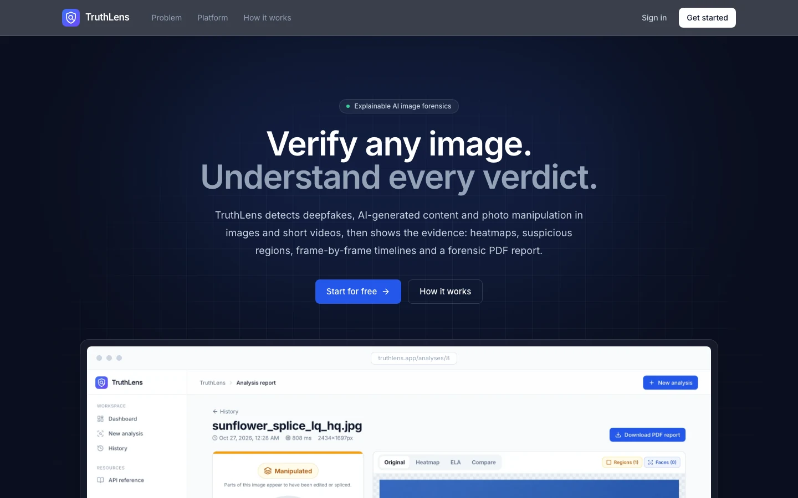

*GL Bajaj Institute of Technology & Management, Greater Noida · Department of CSE · Mini Project 2026–27*

</div>

---

## 📑 Table of contents

1. [The problem](#-the-problem)
2. [What TruthLens does](#-what-truthlens-does)
3. [Feature overview](#-feature-overview)
4. [Step-by-step user guide (with screenshots)](#-step-by-step-user-guide)
   - [A. Create an account](#a-create-an-account)
   - [B. Dashboard](#b-dashboard)
   - [C. Analyze an image](#c-analyze-an-image)
   - [D. Analyze a video](#d-analyze-a-video)
   - [E. History, PDF reports & mobile](#e-history-pdf-reports--mobile)
5. [System architecture](#-system-architecture)
6. [How the AI works — image pipeline](#-how-the-ai-works--image-pipeline)
7. [How the AI works — video pipeline](#-how-the-ai-works--video-pipeline)
8. [Data: database, storage, models & evaluation data](#-data-database-storage-models--evaluation-data)
9. [Tech stack](#-tech-stack)
10. [Getting started](#-getting-started)
11. [Configuration](#-configuration)
12. [REST API reference](#-rest-api-reference)
13. [Project structure](#-project-structure)
14. [Testing, CI & quality](#-testing-ci--quality)
15. [Performance](#-performance)
16. [Security & privacy](#-security--privacy)
17. [Known limitations](#-known-limitations)
18. [Future scope](#-future-scope)
19. [Team](#-team)
20. [Responsible-AI statement & credits](#-responsible-ai-statement--credits)

---

## ❗ The problem

Generative AI has made photorealistic face-swaps, deepfakes and fully synthetic images cheap, fast and
available to anyone. Manipulated media is used for misinformation, financial fraud, identity theft and
fabricated evidence.

| Statistic | Source |
|---|---|
| **15,736+** verified deepfake attack victims in H1 2026 alone | Resemble AI H1 2026 Deepfake Threat Report |
| **1 in 5** biometric fraud attempts now involve a deepfake | Entrust 2026 Identity Fraud Report |
| **0.1 %** of people reliably tell AI-generated images from real ones | iProov Threat Intelligence Report 2025 |

Forensic verification today relies on scarce, expert-only tools that return a black-box "real / fake"
label with no explanation, and **no accessible platform combines detection, explanation and recovery
of damaged evidence in one workflow.**

## 💡 What TruthLens does

TruthLens is a **self-serve, full-stack forensic web platform**:

```
 Upload image / video ──► Forensic + deep-learning analysis ──► Weighted decision engine
        │                                                              │
        ▼                                                              ▼
  Saved privately            Verdict + 0–100 authenticity score + confidence + uncertainty note
  to your account            Heatmaps · suspicious-region boxes · per-signal reasoning · timeline
                             Optional labelled AI restoration · forensic PDF report · history
```

It never claims certainty: every verdict is presented as **probabilistic evidence**, with the reasoning and
the limits spelled out, for a human to review.

| | Existing tools | TruthLens |
|---|---|---|
| **Verdict** | Binary "real / fake" label | Confidence-scored verdict with uncertainty notes |
| **Coverage** | One check — metadata *or* one model | Forensic heuristics + deepfake model + AI-generated model (+ temporal checks for video) |
| **Explainability** | Black box | Heatmaps, region boxes, per-signal explanations, frame timeline |
| **Recovery** | Not offered | Labelled AI restoration of flagged regions |
| **Accessibility** | Expert desktop tools / paid enterprise SaaS | Free self-serve web app, works on mobile |
| **Auditability** | No record of past checks | Per-user history, dashboard and downloadable PDF reports |

## ✨ Feature overview

| Area | Features |
|---|---|
| 🖼️ **Image analysis** | EXIF/metadata forensics · Error Level Analysis (ELA) · sensor-noise consistency · frequency-domain (FFT) artifacts · face detection + per-face deepfake probability · whole-image AI-generated detection |
| 🎬 **Video analysis** | Even frame sampling · per-frame face deepfake + AI-generated scores · temporal consistency · container-metadata check (Sora/Runway/Pika/… and face-swap tool tags) · partially-synthetic segment detection · interactive suspicion timeline |
| 🧠 **Decision engine** | Weighted fusion of available signals → 4-way verdict, 0–100 authenticity score, confidence (capped at 95 %), plain-English summary and uncertainty note |
| 🔥 **Explainability** | Heatmap overlay, ELA map, suspicious-region and face boxes, signal cards with weights and explanations, most-suspicious frames |
| 🪄 **Restoration** | OpenCV Telea inpainting of auto-detected or hand-drawn regions (rectangles / brush mask), stamped **AI-RECONSTRUCTED** |
| 📄 **Reporting** | Multi-page forensic PDF for every image and video analysis (verdict, signals, heatmaps, timeline chart, metadata, disclaimer) |
| 📊 **Workspace** | Dashboard (totals, 7-day trend, verdict distribution, recent items) · searchable/filterable history of images and videos · delete with cascade |
| 🔐 **Accounts** | JWT auth, bcrypt password hashing, strict per-user data isolation |
| 🚀 **Ops** | Docker Compose (PostgreSQL + FastAPI + nginx), Alembic migrations, GitHub Actions CI, Makefile, health checks, graceful ML degradation |

---

## 🧭 Step-by-step user guide

> Everything below was captured from the running application.

### A. Create an account

1. Open the app (`http://localhost:5173` in development, `http://localhost:8080` with Docker).
2. Click **Get started**, fill in name, email and a password (≥ 8 characters) and submit.
3. You are signed in immediately; the JWT is stored in the browser and sent with every API request.

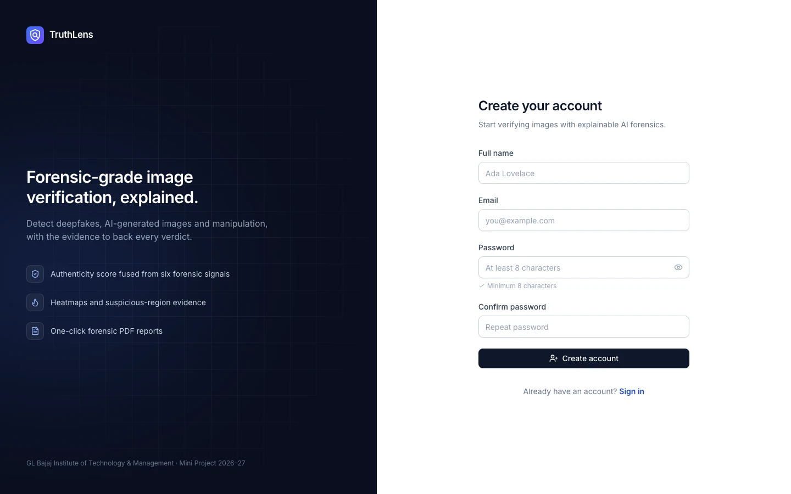

### B. Dashboard

After login you land on the **Dashboard**: total analyses (split into images · videos), average
authenticity, number of flagged items, counts per verdict, a 7-day stacked chart, the verdict
distribution and your most recent analyses. The sidebar shows the **AI engine status** (live from
`/api/health`) — green means the forensic checks *and* deep models are loaded.

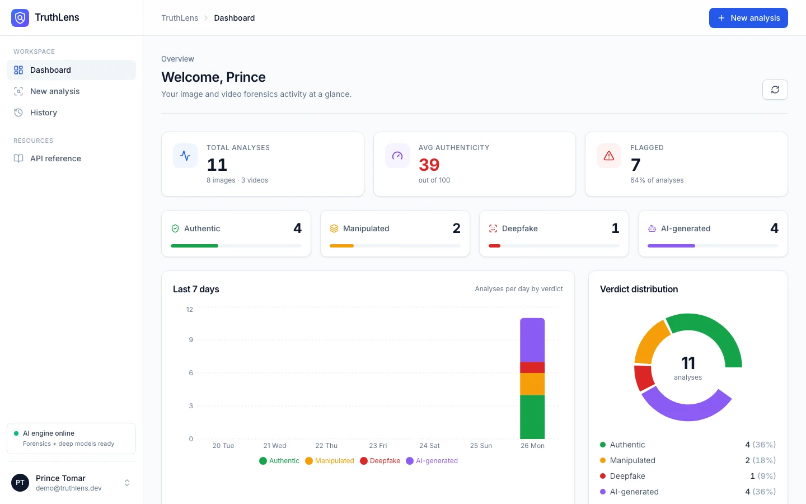

### C. Analyze an image

**Step 1 — Upload.** Go to **New analysis** (or the blue **+ New analysis** button), keep the **Image** tab,
then drag & drop or browse a JPEG / PNG / WebP up to 10 MB. The file is checked in the browser and again
on the server (real content is decoded with Pillow, not just the extension).

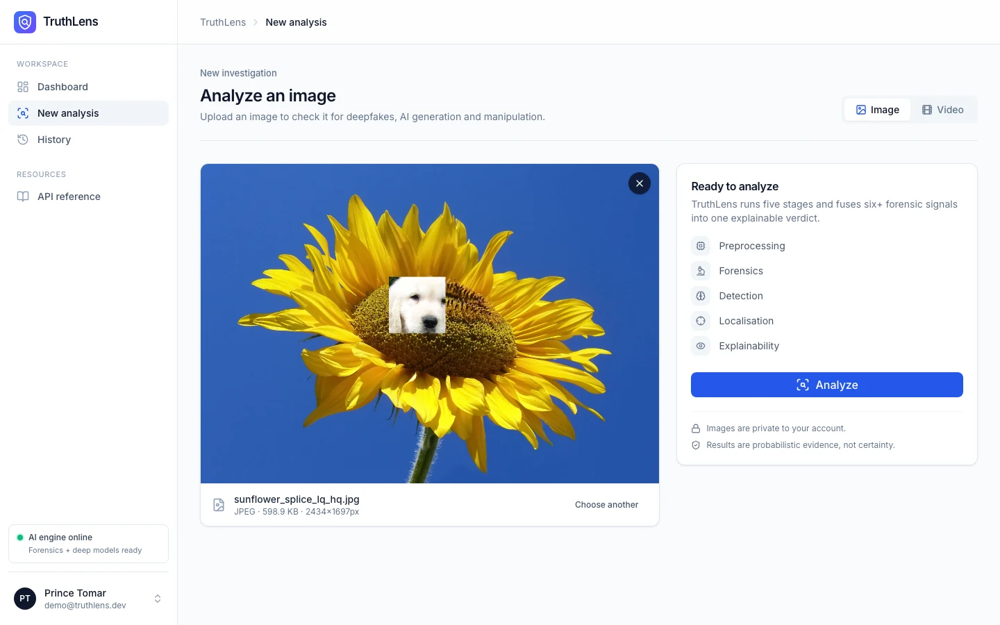

**Step 2 — Analyze.** Click **Analyze**. A staged progress view runs through *Preprocessing → Forensics →
Detection → Localisation → Explainability* (typically 0.3–1.5 s after the models are warm).

**Step 3 — Read the verdict.** The result page shows the verdict badge, the 0–100 **authenticity score**
gauge (100 = authentic), the confidence, a plain-English summary and a **Caution** note explaining what the
system could and could not check. Suspicious regions (solid boxes) and faces (dashed boxes) are drawn on the
image. In this example a dog's face was pasted into a sunflower — TruthLens finds it and scores the image
**18 / 100, Manipulated**.

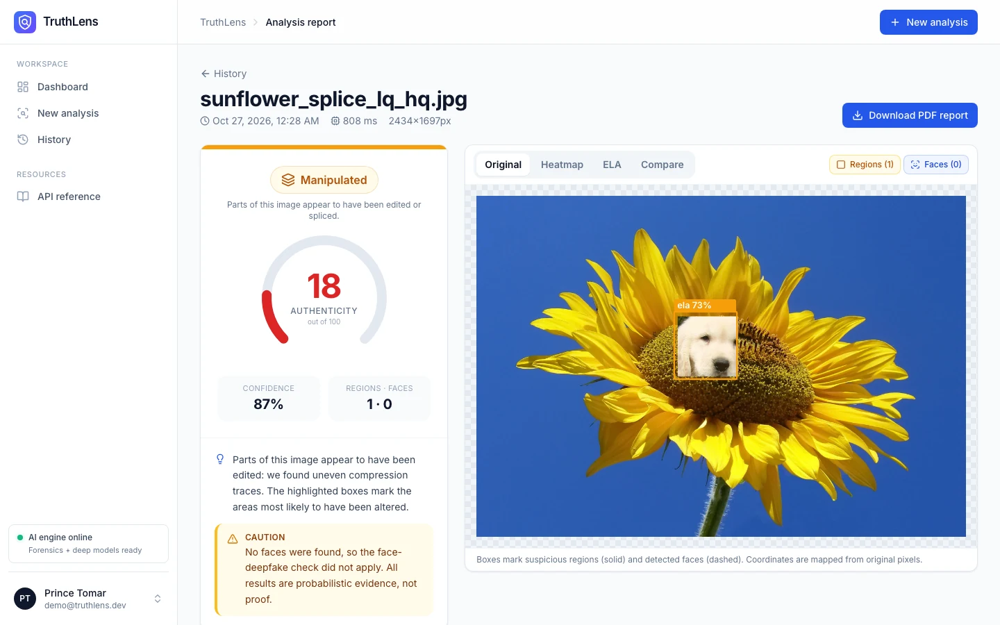

**Step 4 — Inspect the evidence.** Switch between **Original · Heatmap · ELA · Compare** (drag slider).
Warm colours in the heatmap mark the areas that contributed most to the verdict; the ELA view shows
compression-error differences — pasted content often "glows".

| Heatmap | Error Level Analysis |
|---|---|
|  | 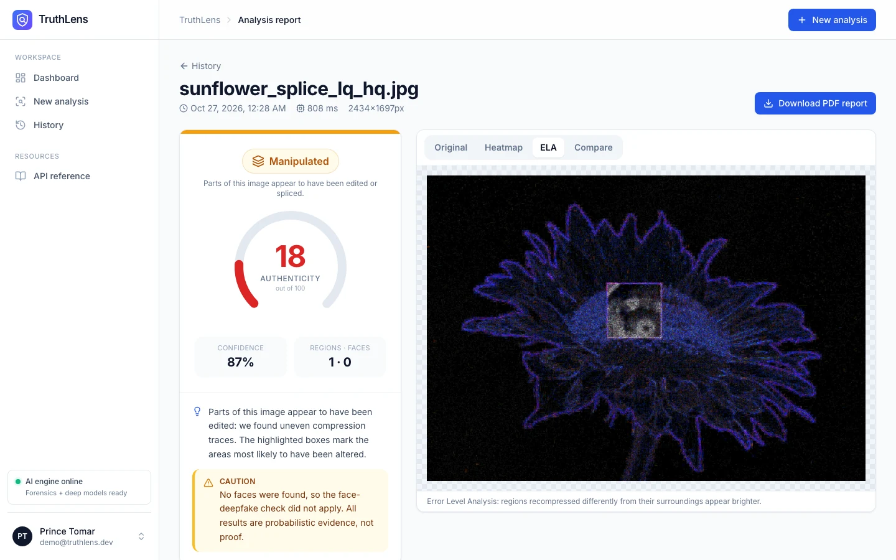 |

**Step 5 — Understand each signal.** Every forensic signal has a card with its suspicion score, its
weight in the final decision and an explanation. Signals that could not run (e.g. *no face → no deepfake
check*) are greyed out and excluded from the weighting. Below: detected faces, metadata/EXIF and the
suspicious-regions table with the exact model versions used.

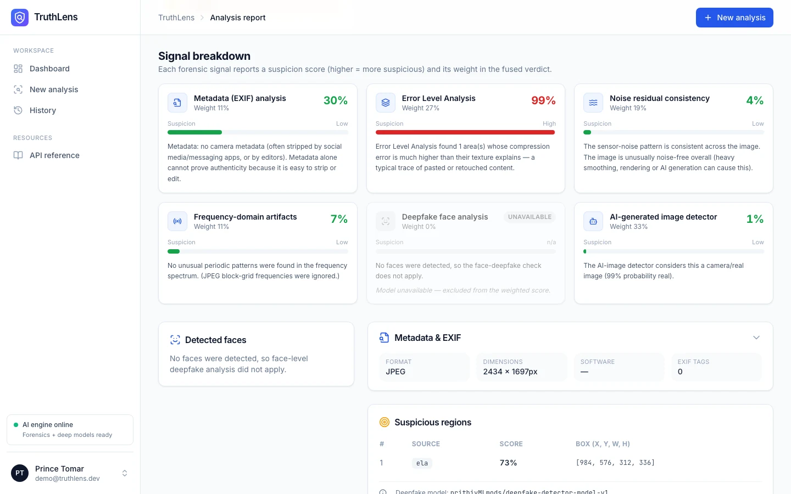

**Step 6 — Restore (optional).** **Restore flagged regions** inpaints the detected areas automatically;
**Mark region manually** lets you draw rectangles or paint a mask. The output is compared with the original
in a before/after slider and is always labelled *AI-reconstructed — not original evidence*.

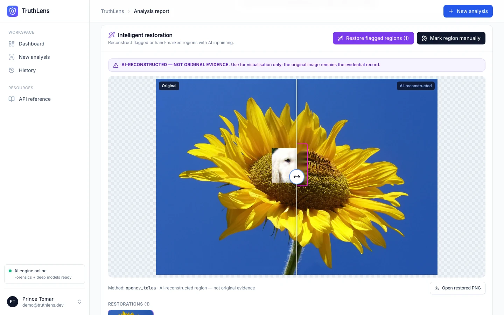

**Step 7 — Download the report.** **Download PDF report** produces a forensic report (see section E).

### D. Analyze a video

**Step 1 — Switch to Video.** On **New analysis** choose the **Video** tab (or open `/analyze?type=video`).
Drop an MP4 / MOV / WebM / AVI / MKV up to 100 MB. You get an inline preview with duration and resolution.

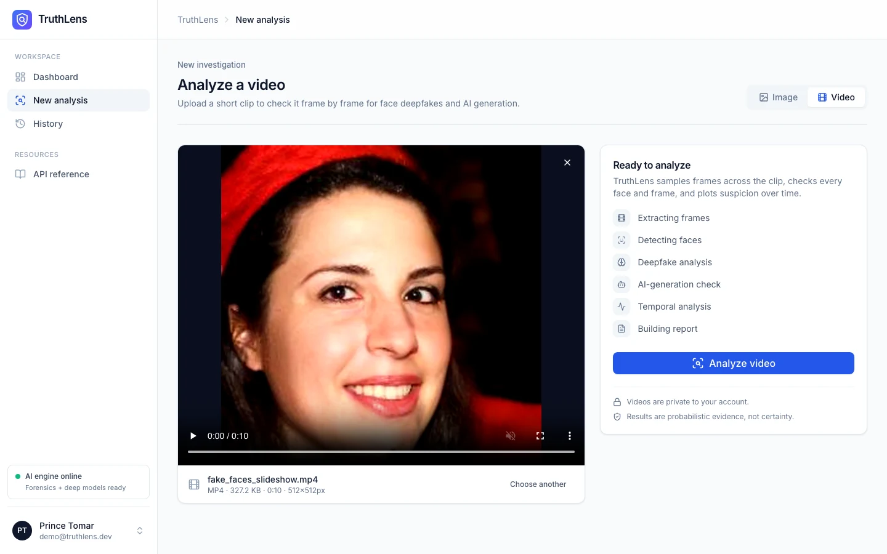

**Step 2 — Analyze.** Click **Analyze video**. The upload progress bar is followed by the analysis stages
*Extracting frames → Detecting faces → Deepfake analysis → AI-generation check → Temporal analysis →
Building report* (≈ 4–13 s for typical clips).

**Step 3 — Read the verdict and the timeline.** The video report shows the verdict, score, confidence, the
number of frames analysed and how many contained faces, the summary and caution note, a player, and the
**suspicion timeline** (fused suspicion, face-deepfake and AI-generated probability per sampled frame, with
the borderline zone shaded). **Click any point on the timeline to jump the video to that moment.**
Example: a slideshow of GAN-generated faces → **Deepfake, 28 / 100**.

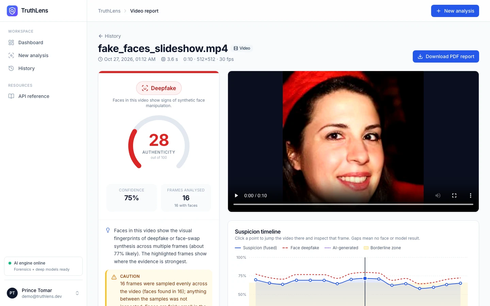

**Step 4 — Inspect frames.** All sampled frames are shown with timestamps and suspicion bars; the most
suspicious ones are badged (#1–#4). Selecting a frame shows it with face boxes, its heatmap, and the
per-frame scores.

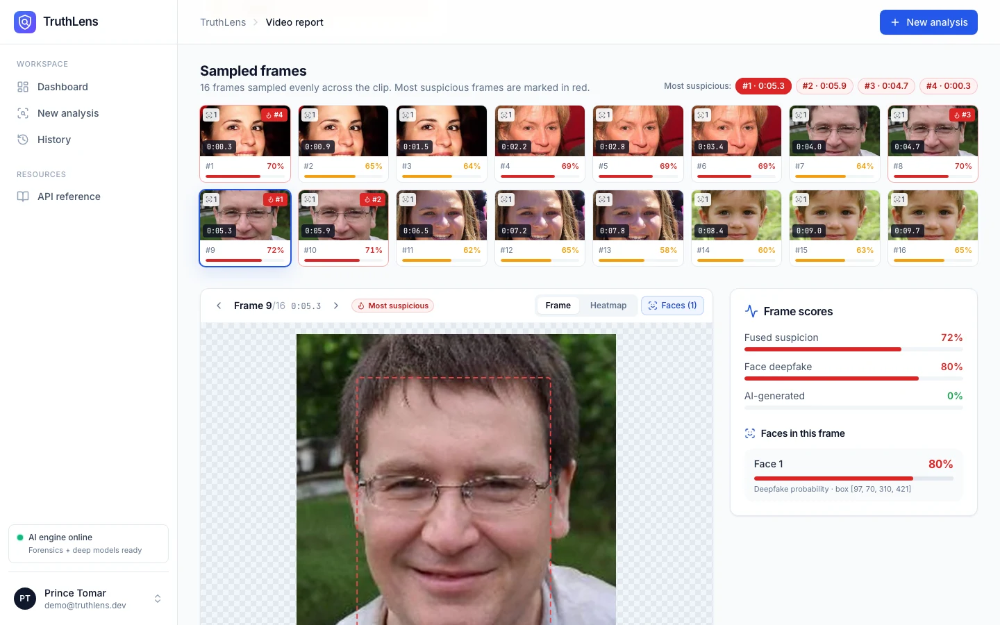

**Partially synthetic clips are caught too.** Here a real clip has an AI-generated segment spliced into
the middle. The whole-video average is diluted, but the consecutive-segment rule flags it:
**AI-generated, 5 / 100 — "in 6 consecutive sampled frames (about 5.1 s to 9.8 s) the frames look
AI-generated"**, and the timeline shows exactly where.

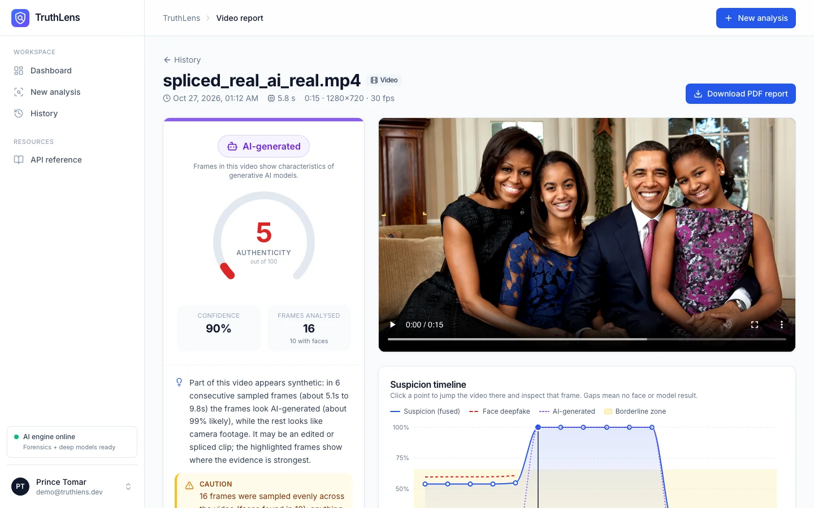

### E. History, PDF reports & mobile

**History** lists every image and video analysis with thumbnail, verdict, score, confidence and date.
Search by filename, filter by verdict and by media type (All / Images / Videos), open or delete items
(deleting removes the files and all related analyses).

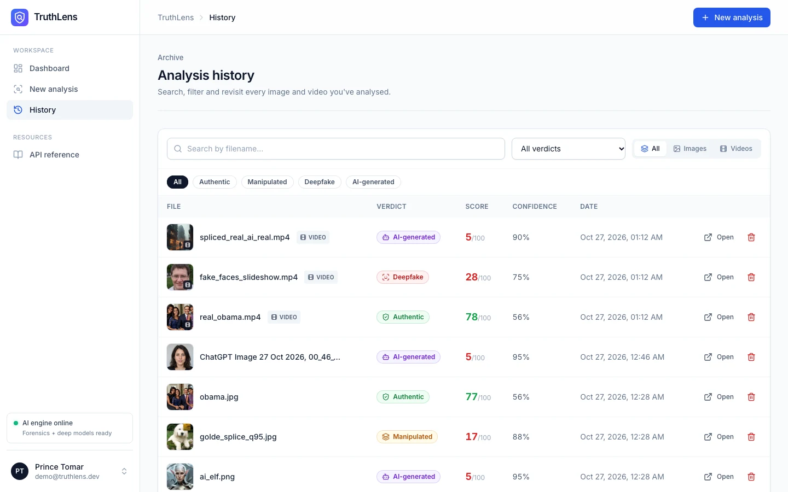

**PDF forensic reports** — generated on first download and cached:

| Image report (page 1) | Video report (timeline & frames page) |
|---|---|
| 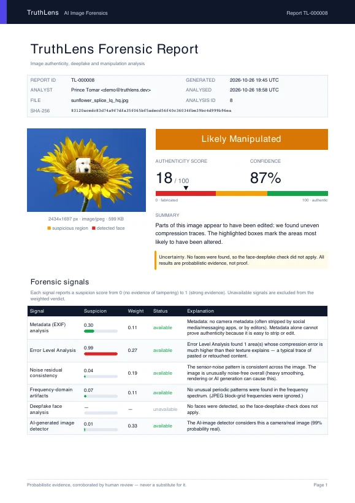 | 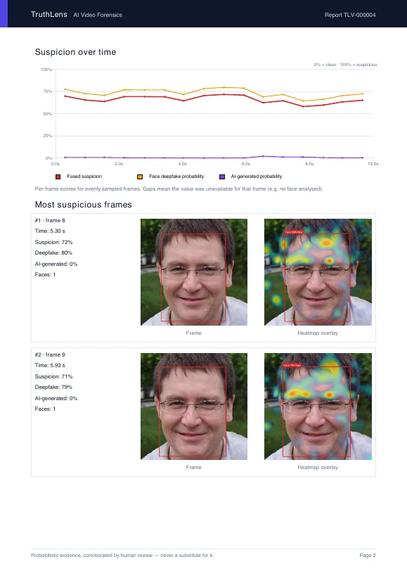 |

**Fully responsive** — the same app on a phone:

<p align="center">
  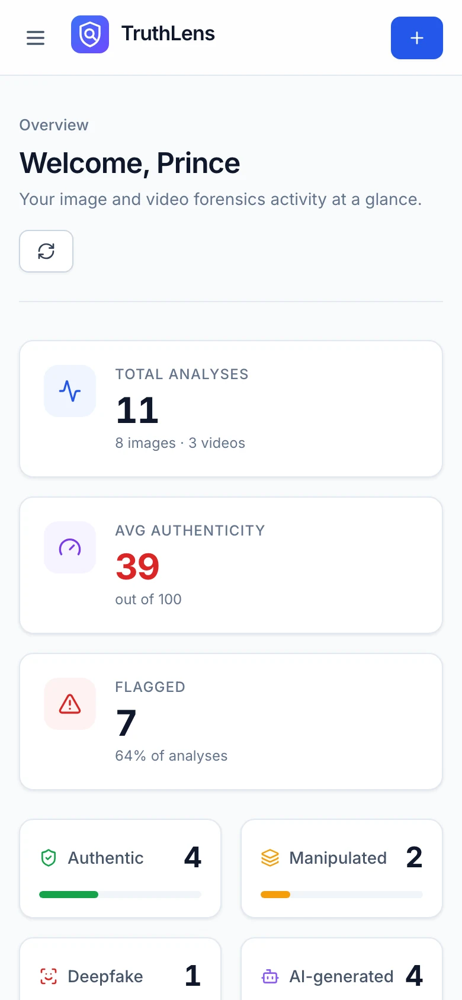
  &nbsp;&nbsp;
  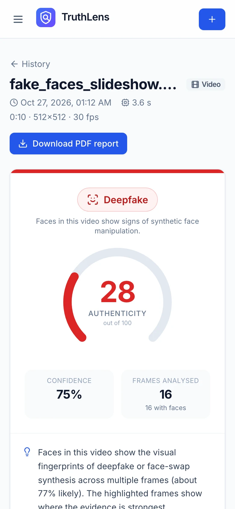
</p>

---

## 🏗️ System architecture

### High-level architecture

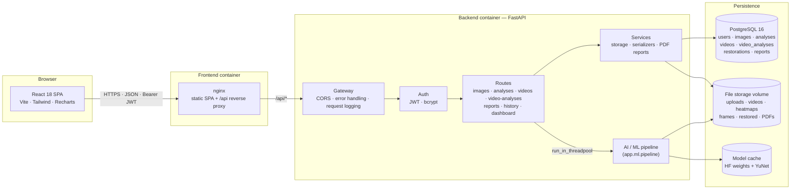

**Design decisions**

- **Contract-first:** every layer builds against one shared contract ([docs/CONTRACT.md](docs/CONTRACT.md)) —
  endpoint paths, JSON shapes, database tables and the ML interface. The backend imports *only* three
  functions from the ML package for images (`analyze_image`, `restore_image`, `warmup`) and two for video
  (`probe_video`, `analyze_video`), so the AI can evolve independently.
- **Synchronous analysis in a thread pool:** analyses take seconds, so a request/response model keeps the
  system simple (no queue). CPU-bound ML runs in `run_in_threadpool` so the event loop stays responsive.
- **Models load once, lazily, behind a lock**, preloaded by a background `warmup()` at startup. A model
  that fails to load is retried later and its signal is marked *unavailable* — the API never crashes
  because of ML.
- **Write-then-commit:** the pipeline writes into a temporary directory; the DB row is created and the
  directory renamed only after success, so a failure never leaves half-written results.
- **Same code in dev and prod:** SQLite locally (zero setup), PostgreSQL in Docker — SQLAlchemy 2.0 +
  Alembic migrations keep both in sync. The frontend always calls relative `/api/...` URLs (Vite proxy in
  dev, nginx in prod).

### Request lifecycle — image analysis

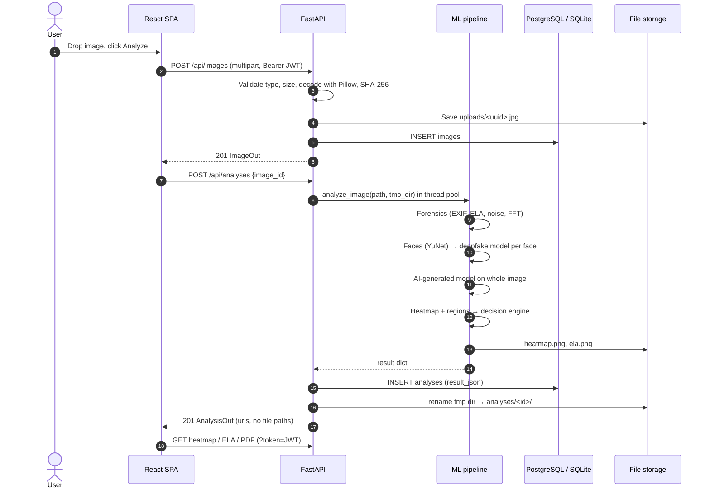

### Request lifecycle — video analysis

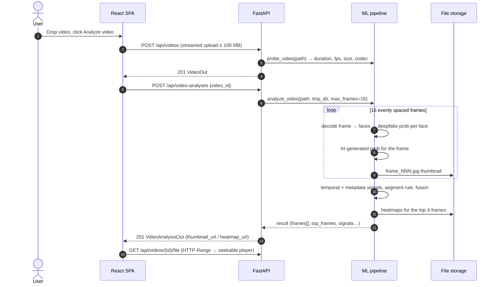

### Deployment topology (Docker Compose)

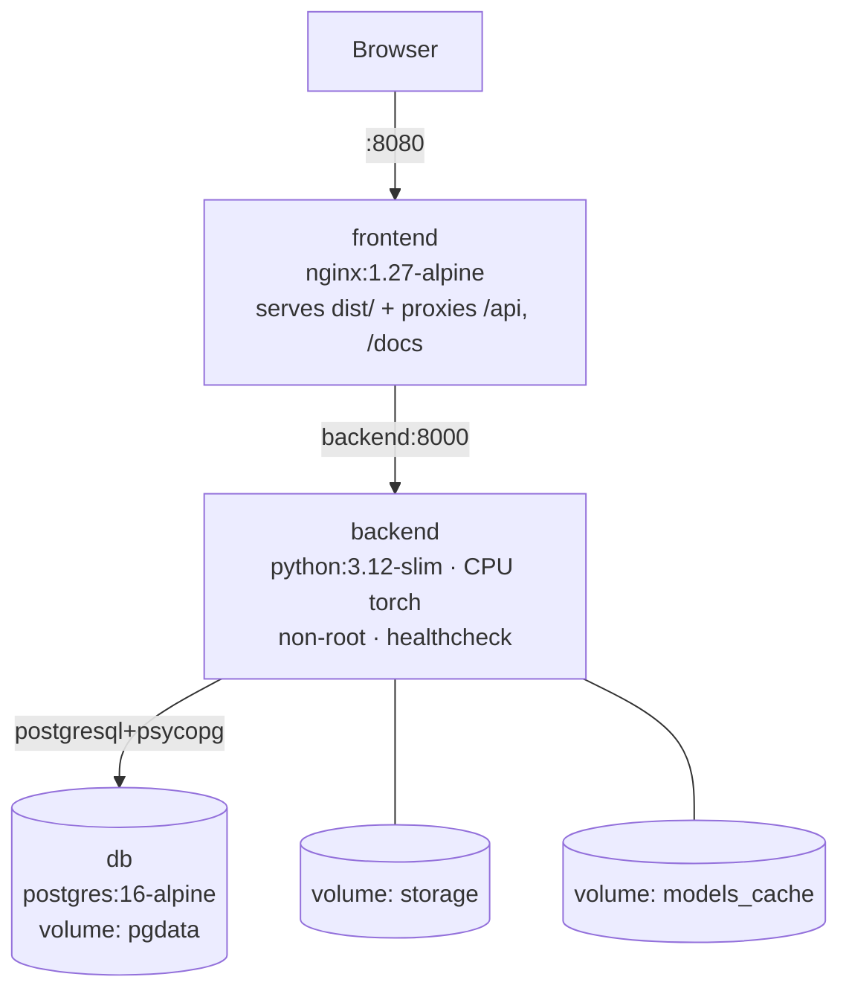

The backend entrypoint waits for PostgreSQL, runs `alembic upgrade head`, then starts Uvicorn. Model
weights can be baked into the image at build time (`PRELOAD_MODELS=true`).

---

## 🧠 How the AI works — image pipeline

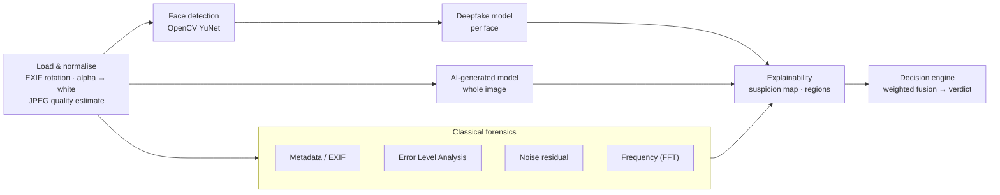

### Signals

| Signal | What it measures | Why it works | Weight |
|---|---|---|---|
| **Metadata (EXIF)** | Camera tags, editing software (Photoshop, GIMP, Lightroom, Snapseed…), AI-generator traces (PNG `parameters`/`prompt` chunks, Stable Diffusion, Midjourney, DALL·E, Firefly, ComfyUI, IPTC *trainedAlgorithmicMedia*), C2PA manifests | Generators and editors often leave fingerprints in metadata; phone firmware strings are *not* treated as editing | 0.08 |
| **Error Level Analysis** | Re-save at JPEG q≈90 and compare per block; flag clusters whose error is higher than their texture predicts | Pasted or retouched content has a different compression history than the rest of the image | 0.20 |
| **Noise residual** | Per-block sensor-noise level from the flattest pixels; flag clusters much noisier/smoother than expected | Every camera sensor leaves a consistent noise pattern; spliced regions break it | 0.14 |
| **Frequency (FFT)** | Periodic peaks in the spectrum (JPEG 8×8 grid excluded) | GAN/diffusion up-sampling leaves periodic artifacts | 0.08 |
| **Face deepfake** | Deepfake probability for every detected face (SigLIP classifier) | Learned facial-synthesis artifacts | 0.25 |
| **AI-generated** | Probability the whole image is synthetic (SwinV2 classifier) | Learned diffusion/GAN image statistics | 0.25 |

Weights are **re-normalised over the signals that actually ran** (e.g. no face → the deepfake weight is
redistributed). PNG/WebP files have no JPEG history, so ELA is down-weighted for them.

### Decision rules (in order)

| Rule | Verdict |
|---|---|
| Highest face deepfake probability ≥ **0.70** | `deepfake` |
| AI-generated probability ≥ **0.80**, or metadata names a generator | `ai_generated` |
| Combined ELA/noise tampering evidence ≥ **0.60**, or overall fused suspicion ≥ **0.55** | `manipulated` |
| Otherwise | `authentic` |

- **Authenticity score:** authentic verdicts map to 55–100, all others to ≤ 45.
- **Confidence:** capped at **0.95** (never certainty) and reduced when checks were unavailable.
- **Borderline bands** (face 0.45–0.70, AI 0.50–0.80) are reported in the uncertainty note.

### Explainability

Both deep models have heads whose "fake" score decomposes exactly into per-patch contributions, so the
heatmap shows where *the model's* evidence lies without needing gradients; it is blended with the ELA and
noise maps, and region/face boxes are drawn on top. The `regions` list gives boxes in original-image pixels.

### Restoration

A mask is built from the user's boxes / painted mask (or the top suspicious regions), slightly dilated, then
filled with **OpenCV Telea inpainting**. The output is outlined and stamped **AI-RECONSTRUCTED**. Masks over
60 % of the image are refused (only labelled), because inpainting cannot invent that much content honestly.

---

## 🎬 How the AI works — video pipeline

ELA and sensor-noise analysis are **not** used on video — codecs re-compress every frame and destroy those
traces. Instead TruthLens reuses the deep models frame by frame and adds video-specific signals.

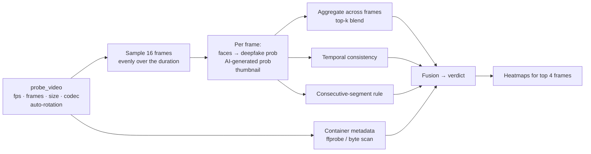

| Step | Detail |
|---|---|
| **Probing** | OpenCV/FFmpeg with auto-rotation (phone videos report display orientation). Missing/bogus frame counts (common in WebM) fall back to ffprobe or counting. Still images renamed `.mp4` are rejected. |
| **Sampling** | `VIDEO_MAX_FRAMES` (default 16, max 64) frames spaced evenly; seek by frame index → by timestamp → sequential read fallback. |
| **Face-size correction** | The face model was trained on large, clean stills and over-reacts to small compressed video faces, so each face's probability is pulled toward 0.5 by size: `p' = 0.5 + (p − 0.5) · clip((size − 64) / 336, 0.2, 1)`. Faces ≥ 400 px are trusted fully; the raw value is kept as `model_probability`. |
| **Aggregation** | `deepfake = 0.75 · mean(top-k frames) + 0.25 · median`, `ai_generated = 0.60 · mean(top-k) + 0.40 · median`, with `k = max(2, ⌈n/4⌉)` — strong frames count, a single outlier doesn't decide. |
| **Temporal signal** | How much per-frame deepfake/AI scores jump between neighbouring samples and how often faces appear/disappear (weak hint). |
| **Metadata signal** | Encoder tags plus AI-video generators (Sora, Runway/Gen-3, Pika, Luma Dream Machine, Kling, Veo, Synthesia, HeyGen, D-ID…), face-swap tools (DeepFaceLab, FaceFusion, Roop…), editors, camera tags, C2PA. |
| **Segment rule** | If ≥ 3 consecutive samples (and ≥ 15 % of samples) each score ≥ 0.90 AI or ≥ 0.72 corrected deepfake, the verdict follows that segment even if the average is lower (one slightly weaker frame allowed; confidence × 0.9). This catches **spliced / partially synthetic** clips. |
| **Fusion weights** | deepfake 0.40 · AI-generated 0.35 · metadata 0.15 · temporal 0.10 (re-normalised); thresholds shared with the image engine. |

---

## 🗄️ Data: database, storage, models & evaluation data

### Entity-relationship diagram

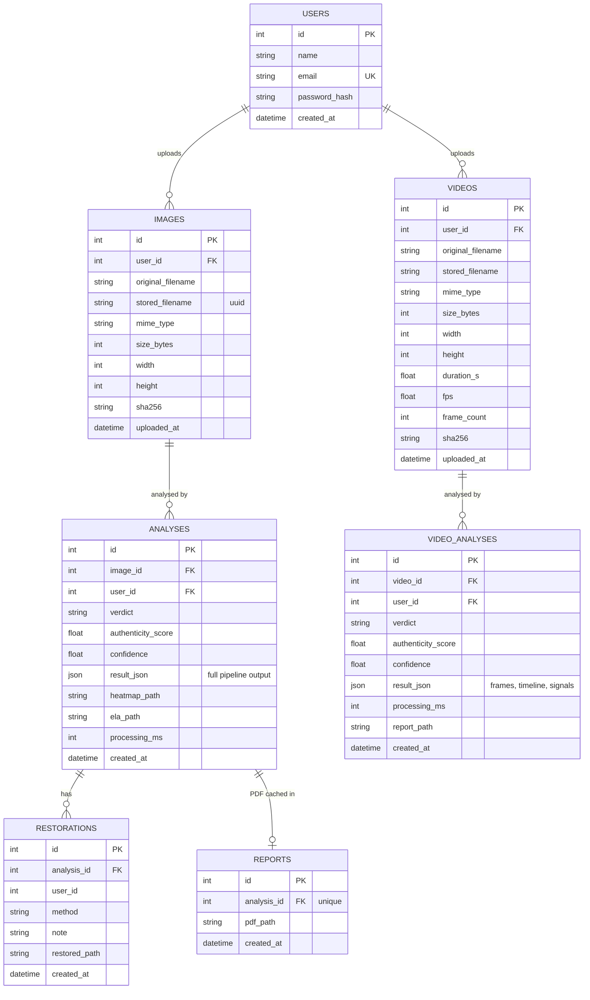

All foreign keys cascade on delete. `sqlalchemy.JSON` is used (not JSONB) so the same schema runs on
SQLite and PostgreSQL. Migrations: `0001_initial_schema` (images) → `0002_video_analysis` (videos).

### File storage layout (`STORAGE_DIR`)

```
storage/
├── uploads/<uuid>.<ext>            original images
├── analyses/<id>/heatmap.png, ela.png
├── restored/                       AI-reconstructed outputs (PNG)
├── reports/report-<id>.pdf         cached image reports
├── videos/<uuid>.<ext>             original videos
└── video_analyses/<id>/            frame_NNN.jpg thumbnails, frame_NNN_heat.jpg, report PDF
```

Paths are stored **relative to `STORAGE_DIR`**, so the folder can be mounted anywhere (Docker volume).
File paths never leave the server — the API only returns URLs.

### What a result looks like (abridged)

```json
{
  "verdict": "manipulated",
  "authenticity_score": 18.0,
  "confidence": 0.87,
  "summary": "Parts of this image appear to have been edited: we found uneven compression traces…",
  "uncertainty_note": "No faces were found, so the face-deepfake check did not apply…",
  "signals": [
    {"key": "ela", "label": "Error Level Analysis", "score": 0.99, "weight": 0.27, "available": true,
     "explanation": "Error Level Analysis found 1 area(s) whose compression error is much higher…"}
  ],
  "regions": [{"box": [984, 576, 312, 336], "score": 0.73, "source": "ela"}],
  "faces": [],
  "model_versions": {"deepfake": "prithivMLmods/deepfake-detector-model-v1",
                     "ai_generated": "haywoodsloan/ai-image-detector-deploy"}
}
```

### Pretrained models

No model was trained from scratch; TruthLens builds the forensic system *around* pretrained detectors.
Candidates were benchmarked on held-out samples before choosing:

| Purpose | Model | Architecture / input | Labels | Why it was chosen | Licence |
|---|---|---|---|---|---|
| Face deepfake | [`prithivMLmods/deepfake-detector-model-v1`](https://huggingface.co/prithivMLmods/deepfake-detector-model-v1) | SigLIP-base, 224 px (372 MB) | `0: Fake, 1: Real` | 46/50 correct on real vs. StyleGAN faces (140k-faces sample); alternatives scored 21/40 and ~50 % | Apache-2.0 |
| AI-generated image | [`haywoodsloan/ai-image-detector-deploy`](https://huggingface.co/haywoodsloan/ai-image-detector-deploy) | SwinV2, 256 px (781 MB) | `0: artificial, 1: real` | 8/8 on SD vs. real sample; three alternatives misclassified real photos | Apache-2.0 |
| Face detection | OpenCV YuNet (`face_detection_yunet_2023mar.onnx`) + Haar fallback | CNN, 230 KB | boxes + landmarks | Fast on CPU, no extra dependency | MIT / BSD |

Either detector can be swapped via `ML_DEEPFAKE_MODEL` / `ML_AIGEN_MODEL`; labels are mapped automatically.
Total model cache ≈ **1.1 GB** (`make models` / `scripts/download_models.py`).

### Evaluation data used during development

Sanity-check sets (public-domain / openly licensed, kept outside the repo):

- **Real photos:** phone photos (iPhone, Samsung), Wikimedia Commons portraits and scenes.
- **Manipulations:** generated from real photos — splices at JPEG q95 / q85, low→high-quality splice,
  copy-move, blur retouch.
- **Fake faces:** StyleGAN faces from the *140k Real and Fake Faces* set.
- **AI images:** Stable Diffusion outputs (JPEG, PNG, WebP).
- **Videos:** four real interview clips from Wikimedia Commons (368p–1080p), photo pans, a GAN-face
  slideshow, real→GAN→real and real→AI→real splices, a 30 s 1080p timing clip.

**Image results**

| Input | Verdict | Score |
|---|---|---|
| Unedited phone/Commons photos (also recompressed q80, saved as PNG) | authentic ✅ | 87–98 |
| Splice saved at q95 / low-quality splice / blur retouch | manipulated ✅ | 17–18 |
| Copy-move | manipulated ✅ | 41 |
| Stable Diffusion images (JPEG/PNG/WebP) | ai_generated ✅ | 5 |
| StyleGAN fake face | deepfake ✅ (1 of 2 samples; the other borderline) | 18 |
| Splice saved at q85 | ❌ missed (authentic) | — |

**Video results**

| Clip | Truth | Verdict | Score |
|---|---|---|---|
| 4 real interview clips (Commons) | real | authentic ✅ (2 borderline) | 75–84 |
| Real photo pans / 30 s 1080p real clip | real | authentic ✅ | 72–92 |
| GAN-face slideshow | fake | deepfake ✅ | 28 |
| Real → GAN faces → real splice | partly fake | deepfake (partial) ✅ | 29 |
| Real → AI scene → real splice | partly AI | ai_generated (partial) ✅ | 5 |
| Stable Diffusion image pans | AI | ai_generated ✅ | 5 |

These are sanity checks on small sets, **not** a benchmark — see [Known limitations](#-known-limitations).

---

## 🧰 Tech stack

| Layer | Technology | Version | Used for |
|---|---|---|---|
| **Frontend** | React | 18.3 | SPA, component architecture, Context for auth & toasts |
| | Vite | 5.4 | Dev server with `/api` proxy, production build with code splitting |
| | Tailwind CSS | 3.4 | Design system (tokens, `.btn`, `.card`), responsive layout |
| | React Router | 6 | Public, guest-only and protected routes |
| | Recharts | 2.15 | Dashboard trend/donut, video suspicion timeline |
| | Axios · lucide-react | 1.7 · 0.468 | API client with JWT interceptor · icon set |
| **Backend** | FastAPI · Uvicorn | 0.162 | REST API, OpenAPI/Swagger docs, async I/O |
| | Pydantic v2 · pydantic-settings | 2 | Request/response schemas, env configuration |
| | SQLAlchemy · Alembic | 2.1 · 1.x | ORM (typed `Mapped` models), schema migrations |
| | PostgreSQL · SQLite | 16 · 3 | Production DB · zero-setup dev/test DB |
| | python-jose · bcrypt | – | JWT signing · password hashing |
| | ReportLab | 5.1 | Forensic PDF reports with charts |
| **AI / ML** | PyTorch (CPU) | 2.14 | Inference runtime |
| | Hugging Face Transformers | 4.57 | SigLIP deepfake & SwinV2 AI-image classifiers |
| | OpenCV (headless) | 5.0 | YuNet face detection, video decoding (FFmpeg), inpainting, image ops |
| | Pillow · NumPy · SciPy | – | EXIF, JPEG re-save for ELA, FFT, array maths |
| **DevOps** | Docker · Docker Compose | – | 3-service stack (db, backend, frontend) with volumes & health checks |
| | nginx | 1.27 | Serves the SPA, proxies `/api`, gzip, caching, security headers |
| | GitHub Actions | – | CI: backend tests, frontend lint/build, Docker image builds |
| | Makefile · uv | – | One-command setup / dev / test / build |
| | Pytest · ESLint | – | 63 backend tests · frontend lint |

---

## 🚀 Getting started

### Prerequisites

| Option | Needs |
|---|---|
| Docker (recommended) | Docker Desktop / Engine with Compose v2, ~4 GB RAM free, ~5 GB disk (images + models) |
| Local development | Python 3.11+ (3.12 recommended), Node.js 20+, optional `uv`, optional `ffmpeg/ffprobe` |

### Option 1 — Docker (one command)

```bash
git clone https://github.com/lalamansingh/Chill-Fun-Hacakthon.git
cd Chill-Fun-Hacakthon
cp .env.example .env          # set SECRET_KEY for anything public
docker compose up --build     # first build downloads ~1.1 GB of model weights
```

| Service | URL |
|---|---|
| Web app | http://localhost:8080 |
| API docs (Swagger) | http://localhost:8080/docs (also http://localhost:8000/docs) |
| Health | http://localhost:8080/api/health |

Faster build without baking models into the image: `PRELOAD_MODELS=false docker compose up --build`
(models then download on first use). Stop with `docker compose down` (add `-v` to delete data).

### Option 2 — Local development (no Docker)

```bash
make setup     # creates backend/.venv (uv if available), installs Python + npm deps
make models    # optional: pre-download the ~1.1 GB of model weights
make dev       # backend on :8000 (SQLite, auto-migrated) + frontend on :5173
```

Open **http://localhost:5173**, click **Get started** and create an account.

<details>
<summary><b>Manual steps (without make)</b></summary>

```bash
# Backend
cd backend
python3 -m venv .venv && source .venv/bin/activate
pip install -r requirements.txt          # includes requirements-ml.txt (torch, transformers, opencv)
alembic upgrade head                      # creates truthlens.db (SQLite)
uvicorn app.main:app --reload --port 8000

# Frontend (new terminal)
cd frontend
npm install
npm run dev                               # http://localhost:5173, proxies /api to :8000
```

PostgreSQL locally: `make db-up` (starts only Postgres via `docker-compose.dev.yml`) and export the
`DATABASE_URL` it prints. Fast mode without deep models: `ML_ENABLE_DEEP=false`.
</details>

<details>
<summary><b>All make targets</b></summary>

`help` · `setup` · `setup-backend` · `setup-frontend` · `dev` · `dev-backend` · `dev-frontend` · `db-up` ·
`db-down` · `migrate` · `models` · `test` · `test-ml` · `lint` · `build` · `up` · `down` · `logs` · `ps` ·
`clean` · `clean-all`
</details>

---

## ⚙️ Configuration

All settings are environment variables (see [.env.example](.env.example)).

| Variable | Default | Description |
|---|---|---|
| `DATABASE_URL` | `sqlite:///./truthlens.db` | Compose: `postgresql+psycopg://truthlens:truthlens@db:5432/truthlens` |
| `SECRET_KEY` | `dev-secret-change-me` | JWT signing key — **change in production** |
| `ACCESS_TOKEN_EXPIRE_MINUTES` | `1440` | Token lifetime |
| `STORAGE_DIR` | `./storage` | Uploads, heatmaps, frames, restorations, PDFs |
| `CORS_ORIGINS` | `http://localhost:5173` | Comma-separated allowed origins |
| `MAX_UPLOAD_MB` | `10` | Image upload limit |
| `MAX_VIDEO_MB` | `100` | Video upload limit (nginx allows 110 MB) |
| `VIDEO_MAX_FRAMES` | `16` | Frames sampled per video (max 64) |
| `ML_ENABLE_DEEP` | `true` | `false` = classical forensics only (fast, no PyTorch loaded) |
| `MODEL_CACHE_DIR` | `./models_cache` | Hugging Face / YuNet weights |
| `ML_DEEPFAKE_MODEL` / `ML_AIGEN_MODEL` | see models table | Swap detectors without code changes |
| `UVICORN_WORKERS` | `1` | Models load per worker — keep low |
| `PRELOAD_MODELS` | `true` | Docker build arg: bake weights into the image |

---

## 🔌 REST API reference

Base path `/api` · JSON · errors are always `{"detail": "message"}` · auth with `Authorization: Bearer <jwt>`.
Endpoints marked 📎 return files and also accept `?token=<jwt>` (for ``, `<video>`, downloads).
Interactive docs: **`/docs`**. Full schemas: [docs/CONTRACT.md](docs/CONTRACT.md).

| Method | Path | Description |
|---|---|---|
| GET | `/api/health` | Status, deep-ML enabled, models loaded |
| POST | `/api/auth/register` | Create account → `{access_token, user}` |
| POST | `/api/auth/login` | Log in → `{access_token, user}` |
| GET | `/api/auth/me` | Current user |
| POST | `/api/images` | Upload image (multipart `file`; 400 bad type, 413 too large) |
| GET | `/api/images` · `/api/images/{id}` | List / get images |
| GET 📎 | `/api/images/{id}/file` | Original image |
| DELETE | `/api/images/{id}` | Delete image + analyses + files |
| POST | `/api/analyses` | Analyze `{image_id}` → verdict, signals, regions, faces |
| GET | `/api/analyses/{id}` | Analysis result |
| GET 📎 | `/api/analyses/{id}/heatmap` · `/ela` | Heatmap / ELA PNG |
| POST | `/api/analyses/{id}/restore` | Restore `{boxes?, mask_base64?}` |
| GET 📎 | `/api/restorations/{id}/file` | Restored PNG |
| GET 📎 | `/api/reports/{analysis_id}/pdf` | Image PDF report |
| POST | `/api/videos` | Upload video (MP4/MOV/WebM/AVI/MKV ≤ 100 MB, streamed) |
| GET | `/api/videos` · `/api/videos/{id}` | List / get videos |
| GET 📎 | `/api/videos/{id}/file` | Video bytes, **HTTP Range** supported (206) |
| DELETE | `/api/videos/{id}` | Delete video + analyses + files |
| POST | `/api/video-analyses` | Analyze `{video_id}` → verdict, frames timeline, top frames |
| GET | `/api/video-analyses/{id}` | Video analysis result |
| GET 📎 | `/api/video-analyses/{id}/files/{name}` | Frame thumbnail / heatmap (basename only) |
| GET 📎 | `/api/video-analyses/{id}/report` | Video PDF report |
| GET | `/api/history` | `q`, `verdict`, `media` (image/video), `page`, `page_size` |
| GET | `/api/dashboard/stats` | Totals, by verdict, by media, 7-day trend, recent |

Example:

```bash
TOKEN=$(curl -s -X POST localhost:8000/api/auth/login -H 'content-type: application/json' \
  -d '{"email":"you@example.com","password":"yourpassword"}' | jq -r .access_token)
IMG=$(curl -s -H "Authorization: Bearer $TOKEN" -F file=@photo.jpg localhost:8000/api/images | jq .id)
curl -s -H "Authorization: Bearer $TOKEN" -H 'content-type: application/json' \
  -d "{\"image_id\": $IMG}" localhost:8000/api/analyses | jq '{verdict, authenticity_score, confidence}'
```

---

## 📁 Project structure

```
Chill-Fun-Hacakthon/
├── backend/                          FastAPI application
│   ├── app/
│   │   ├── main.py                   app factory, CORS, error handling, logging, warmup
│   │   ├── config.py · database.py · deps.py
│   │   ├── models/                   SQLAlchemy tables (users, images, analyses, videos, …)
│   │   ├── schemas/                  Pydantic request/response models
│   │   ├── routes/                   auth · images · analyses · videos · video_analyses · reports · history
│   │   ├── services/                 security · storage · serializers · ml wrapper · report · video_report
│   │   └── ml/                       AI pipeline
│   │       ├── pipeline.py           public interface (analyze_image, restore_image, probe_video, analyze_video)
│   │       ├── preprocessing.py · decision.py · explain.py · restoration.py · video.py · utils.py
│   │       ├── forensics/            metadata · ela · noise · frequency
│   │       └── detectors/            faces (YuNet) · deepfake · ai_generated · models (lazy loader)
│   ├── alembic/versions/             0001_initial_schema · 0002_video_analysis
│   ├── tests/                        API tests (+ tests/ml for the pipeline)
│   ├── scripts/download_models.py
│   ├── requirements.txt · requirements-ml.txt
│   └── Dockerfile · docker/entrypoint.sh
├── frontend/                         React SPA
│   ├── src/
│   │   ├── pages/                    Landing · Login · Register · Dashboard · Analyze · Result · VideoResult · History
│   │   ├── components/               AppShell · UploadZone · ImageViewer · BoxOverlay · CompareSlider ·
│   │   │                             SignalCard · ScoreGauge · SuspicionTimeline · RestorationPanel · …
│   │   ├── api/ · context/ · lib/
│   ├── nginx.conf · Dockerfile · vite.config.js · tailwind.config.js
├── docs/                             CONTRACT.md · ARCHITECTURE.md · DEPLOYMENT.md · screenshots/
├── .github/workflows/ci.yml
├── docker-compose.yml · docker-compose.dev.yml · Makefile · .env.example
└── README.md
```

---

## ✅ Testing, CI & quality

```bash
make test                     # or: backend/.venv/bin/python -m pytest backend/tests
cd frontend && npm run lint && npm run build
```

**63 backend tests**, all passing:

| Suite | Covers |
|---|---|
| `test_auth.py` | register / login / me, duplicate email (409), bad password (401) |
| `test_images.py` | upload validation (real decode, type, size), file serving |
| `test_isolation.py` | users can never access each other's data (404) |
| `test_flow.py` · `test_rich_result.py` | analyze → history → dashboard → PDF → restore, URL/path hygiene |
| `test_videos.py` | video validation, HTTP Range (206), analysis, path-traversal rejection, report, mixed history, cascade delete |
| `tests/ml/test_pipeline.py` | result shape, JSON types, heatmap/ELA files, splice localisation, EXIF rotation, restoration |
| `tests/ml/test_video.py` | probing (incl. rotation, WebM), sampling, shape, segment rule, deep path |

**CI (GitHub Actions)** runs on every push / PR: backend tests (CPU torch, `ML_ENABLE_DEEP=false`) with an
Alembic smoke test, frontend lint + build, and Docker builds of both images.

---

## ⚡ Performance

Measured on an Apple-Silicon laptop, CPU only, models already cached:

| Task | Time |
|---|---|
| First image analysis in a fresh process (incl. model load) | ~6.5 s |
| Image analysis, warm (typical / 14 MP) | 0.3–1.2 s / 1.3 s |
| Image analysis with `ML_ENABLE_DEEP=false` | 0.3–0.8 s |
| Auto-restoration | ~1.8 s |
| Video, 720p clip (16 frames) | 3–6 s |
| Video, 30 s 1080p H.264 | 7.9 s |
| Video, 6.6 min 1080p VP9 | 12.5 s |

Memory: allow ~2 GB for the backend container (two transformer models in RAM).

---

## 🔐 Security & privacy

- **Authentication:** JWT (HS256) with expiry; passwords hashed with bcrypt.
- **Authorisation:** every image, video, analysis, restoration and report query is scoped to the current
  user — another user's ID returns **404**, not 403, so existence is not leaked.
- **Upload validation:** images are fully decoded with Pillow (decompression-bomb guard, 100 MP cap);
  videos must decode with OpenCV; extension, MIME and size limits are enforced server-side.
- **Path safety:** stored filenames are UUIDs; file endpoints accept only known basenames (path traversal → 404);
  absolute paths never appear in API responses.
- **Containers:** non-root users, Postgres not exposed to the host, backend bound to localhost, nginx
  security headers.
- **Honesty by design:** confidence never exceeds 95 %, restored images are watermarked, and every page and
  report carries the human-review disclaimer.

---

## ⚠️ Known limitations

- **Small sanity sets, not a benchmark.** Accuracy has not been measured on standard datasets
  (FaceForensics++, Celeb-DF, DFDC, GenImage).
- **Deepfake model** was trained on GAN-style face stills: retouched professional portraits score
  0.4–0.6 (reported as borderline), small/compressed video faces are unreliable (hence the size
  correction, which also means deepfakes with faces under ~200 px are mostly missed). Not yet validated on
  real face-swap videos.
- **AI-image detector** is very confident in both directions; heavy filters, upscaling and digital art can
  confuse it. Not yet tested on real Sora/Runway video output.
- **Classical forensics** miss splices saved at medium JPEG quality (q85) with the same history; the
  frequency signal rarely fires.
- **Video** inspects sampled frames only — a spliced section shorter than ~3 sampling intervals can be
  missed. YuNet can detect "faces" on animals or statues.
- **Restoration** uses Telea inpainting, which is blurry on large areas.

## 🔭 Future scope

- **Audio deepfakes:** voice-clone detection and audio–lip-sync consistency for videos.
- **Face tracking** across all video frames instead of sampled frames; dedicated video deepfake models.
- **Benchmarking & continuous learning** on labelled real-world cases (human-reviewed active learning).
- **C2PA / Content Credentials** verification and provenance display.
- **Mobile app & browser extension** for in-place verification; **public platform API** with rate limits
  and webhooks for newsrooms.
- **Blockchain-anchored audit trail** for legal chain-of-custody.
- **Async job queue** (Celery/RQ) and GPU workers for long videos and high traffic.

---

## 👥 Team

**GL Bajaj Institute of Technology & Management, Greater Noida** · Department of Computer Science &
Engineering · B.Tech CSE, Section F · Session 2026–27

| Name | Roll No. | Role |
|---|---|---|
| **Prince Tomar** | 2401920100244 | Team Leader |
| Sachin Kumar | 2401920100276 | Member |
| Piyush Kumar | 2401920100230 | Member |
| Priyanshu Kumar | 2401920100248 | Member |

**Project guide & coordinator:** Mr. Prasanna Dwivedi

---

## ⚖️ Responsible-AI statement & credits

> **Probabilistic evidence, corroborated by human review — never a substitute for it.**

TruthLens supports human judgement; it does not replace it. Results can be wrong, especially on media unlike
the models' training data. Do not use a TruthLens verdict as the sole basis for accusations, legal action
or moderation decisions.

**Credits:** pretrained models by [prithivMLmods](https://huggingface.co/prithivMLmods) and
[haywoodsloan](https://huggingface.co/haywoodsloan) on Hugging Face (Apache-2.0); YuNet from the OpenCV Zoo;
sample media from Wikimedia Commons; built with FastAPI, React, PyTorch, Hugging Face Transformers and OpenCV.

More detail: [docs/ARCHITECTURE.md](docs/ARCHITECTURE.md) · [docs/DEPLOYMENT.md](docs/DEPLOYMENT.md) ·
[docs/CONTRACT.md](docs/CONTRACT.md)
