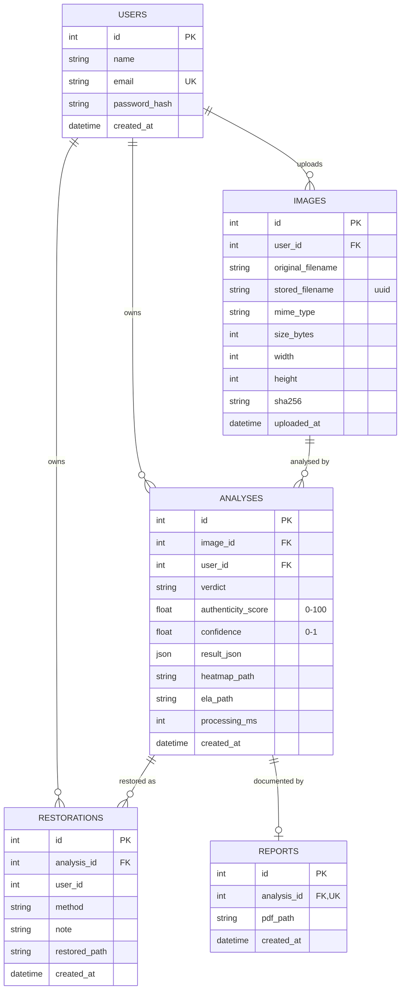

# TruthLens — Architecture

This document describes how TruthLens is structured and how a request moves through it. The interface
contract between the parts (environment variables, DB schema, ML interface, REST API) lives in
[CONTRACT.md](CONTRACT.md).

## 1. Layers

```mermaid
flowchart TB
    subgraph Client
        B[React 18 SPA<br/>Vite build · Tailwind · Recharts]
    end
    subgraph Edge["frontend container (nginx:alpine)"]
        NG[nginx<br/>static SPA + gzip + cache headers<br/>location /api/ → backend:8000]
    end
    subgraph App["backend container (python:3.12-slim, non-root)"]
        API[FastAPI routers<br/>auth · images · analyses · restorations<br/>reports · history · dashboard]
        SVC[Services<br/>security (JWT/bcrypt) · storage · serializers · PDF]
        ML[ML pipeline<br/>app/ml/pipeline.py]
    end
    DB[(PostgreSQL 16<br/>pgdata volume)]
    FS[[File storage<br/>/app/storage volume]]
    MC[[Model cache<br/>/app/models_cache volume]]

    B -- "relative /api/* (JWT)" --> NG
    NG -- "proxy_pass, 300 s read timeout, 12 MB body" --> API
    API --> SVC
    API -- "run_in_threadpool" --> ML
    SVC --> DB
    SVC --> FS
    ML --> FS
    ML -.-> MC
```

| Layer | Responsibility |
|---|---|
| **React SPA** | Auth screens, upload, results viewer (heatmap, boxes, signals), restoration UI, history, dashboard. It always calls relative `/api/...` URLs, so the same build works behind nginx, the Vite proxy or a Vercel rewrite. |
| **nginx** | Serves the static `dist/` bundle with SPA fallback (`try_files … /index.html`), caches hashed `/assets/*` for a year, never caches `index.html`, gzips responses and reverse-proxies `/api/` to FastAPI. Backend DNS is resolved lazily, so nginx starts even before the backend is up. |
| **FastAPI** | Validation (Pydantic v2), JWT auth, per-user authorization, file handling, persistence. Synchronous ML calls run in a threadpool so the event loop stays responsive. |
| **ML pipeline** | `analyze_image`, `restore_image` and `warmup` are the only symbols the backend imports. Classical forensics always run. The deep models run when `ML_ENABLE_DEEP=true` and the weights are available. |
| **PostgreSQL** | Users, images, analyses (full result JSON), restorations and reports. SQLite is used for local development. Migrations are managed with Alembic. |
| **File storage** | `uploads/`, `analyses/<id>/` (heatmap, ELA), `restored/`, `reports/` under `STORAGE_DIR`. |

## 2. Request lifecycle of an analysis

```mermaid
sequenceDiagram
    autonumber
    actor U as User
    participant FE as React SPA
    participant NX as nginx
    participant API as FastAPI
    participant ML as ML pipeline
    participant DB as PostgreSQL
    participant FS as Storage

    U->>FE: choose image
    FE->>NX: POST /api/images (multipart, Bearer JWT)
    NX->>API: proxy (≤ 12 MB)
    API->>API: verify JWT, check MIME/magic bytes, size ≤ MAX_UPLOAD_MB, decode with Pillow
    API->>FS: save uploads/<uuid>.<ext>
    API->>DB: INSERT images (sha256, w×h, …)
    API-->>FE: 201 ImageOut
    FE->>NX: POST /api/analyses {image_id}
    NX->>API: proxy (read timeout 300 s)
    API->>DB: ownership check (404 if not owner)
    API->>ML: analyze_image(path, analyses/<id>/) in threadpool
    ML->>ML: metadata · ELA · noise · frequency
    ML->>ML: face detection → deepfake model; AI-generated model
    ML->>ML: weighted fusion → verdict, score, confidence, uncertainty note
    ML->>FS: heatmap.png, ela.png
    ML-->>API: result dict
    API->>DB: INSERT analyses (verdict, score, result_json, paths, processing_ms)
    API-->>FE: 201 AnalysisOut (heatmap_url, ela_url, report_url)
    FE->>NX: GET /api/analyses/{id}/heatmap?token=…
    NX->>API: proxy
    API-->>FE: PNG
    opt restoration
      FE->>API: POST /api/analyses/{id}/restore {boxes | mask_base64}
      API->>ML: restore_image(...) → PNG labelled "AI-RECONSTRUCTED"
      API->>DB: INSERT restorations
    end
    opt report
      FE->>API: GET /api/reports/{id}/pdf?token=…
      API->>FS: generate once with ReportLab, cache in reports/
      API->>DB: INSERT reports
    end
```

Typical latency on CPU is about 15 s per analysis. The first analysis after a start can take longer if
`warmup()` has not finished loading the models yet. `warmup()` runs in a background thread at startup.

## 3. Database ER diagram



All foreign keys cascade on delete, so deleting an image removes its analyses, restorations and reports. The
backend also removes the files on disk. `result_json` uses the portable `sqlalchemy.JSON` type, so the same
schema works on SQLite and PostgreSQL.

## 4. ML pipeline stages

| # | Stage | Signal key | What it does |
|---|---|---|---|
| 1 | Load & normalise | – | Decode with Pillow, fix EXIF orientation, convert to RGB, record format/size. |
| 2 | Metadata | `metadata` | EXIF presence/consistency, editing-software tags (e.g. Photoshop, generator names), missing camera data. |
| 3 | Error Level Analysis | `ela` | Re-compresses as JPEG at a known quality and amplifies the difference. Regions that were edited recompress differently. Produces `ela.png` and candidate regions. |
| 4 | Noise residual | `noise` | High-pass / denoise residual statistics per block. Splicing breaks the uniform sensor-noise pattern. |
| 5 | Frequency analysis | `frequency` | FFT/DCT spectrum artefacts (periodic peaks, missing high frequencies) typical of GAN/diffusion upsampling. |
| 6 | Deepfake detector | `deepfake` | Face detection, then a pretrained classifier scores each face crop (`faces[].deepfake_probability`). |
| 7 | AI-generated detector | `ai_generated` | Pretrained whole-image classifier for diffusion/GAN-generated content. |
| 8 | Fusion | – | Weighted average over the signals that are *available* (missing models are excluded and the weights renormalised). The result maps to a verdict, a 0–100 authenticity score, a confidence value and an uncertainty note when the signals disagree. |
| 9 | Explainability | – | Merges the region maps (ELA / noise / deepfake / Grad-CAM) into `heatmap.png` overlaid on the image, plus `regions[]` boxes in original pixel coordinates. |
| 10 | Restoration (on demand) | – | Inpaints the given boxes/mask, or the top suspicious regions (OpenCV Telea, or a learned inpainter if available), and stamps a visible **AI-RECONSTRUCTED** label. |

`ML_ENABLE_DEEP=false` skips stages 6–7, which mark themselves `available: false`. Torch is never imported in
that mode, which is how CI and fast local dev run.

### Model credits

| Purpose | Model | Licence |
|---|---|---|
| Face deepfake detection | [`prithivMLmods/deepfake-detector-model-v1`](https://huggingface.co/prithivMLmods/deepfake-detector-model-v1) (SigLIP-base, 224 px) | Apache-2.0 |
| AI-generated image detection | [`haywoodsloan/ai-image-detector-deploy`](https://huggingface.co/haywoodsloan/ai-image-detector-deploy) (SwinV2, 256 px) | Apache-2.0 |
| Face detection | OpenCV YuNet (`face_detection_yunet_2023mar.onnx`), Haar cascade fallback | MIT / BSD (OpenCV Zoo) |

The weights are downloaded by `backend/scripts/download_models.py` into `MODEL_CACHE_DIR`. In Docker they
are baked into the image at build time when `PRELOAD_MODELS=true`.

## 5. Security notes

- **Authentication**: passwords are hashed with bcrypt. Stateless JWTs (HS256) are signed with `SECRET_KEY`
  and expire after `ACCESS_TOKEN_EXPIRE_MINUTES`. `SECRET_KEY` **must** be set to a long random value in any
  shared deployment.
- **Per-user isolation**: every query is scoped by `user_id`. A resource belonging to another user returns
  **404** rather than 403, so its existence is not leaked. File endpoints accept `?token=` only so that
  `` and `<a>` tags work, and they apply the same ownership checks.
- **Upload validation**: an allow-list of JPEG/PNG/WebP, checked by content (Pillow decode) as well as the
  declared type. Size is capped at `MAX_UPLOAD_MB` (backend) and 12 MB (nginx `client_max_body_size`). Files
  are stored under random UUID names and are never served from a user-supplied path.
- **Containers**: the backend runs as an unprivileged `app` user (UID 10001) on a slim base image, with no
  compilers in the runtime stage. nginx worker processes run as `nginx`, and `server_tokens` is off. Postgres
  is not published to the host in the production compose file. The backend port is bound to `127.0.0.1`
  only.
- **Transport & headers**: nginx sets `X-Content-Type-Options`, `X-Frame-Options` and `Referrer-Policy`.
  Terminate TLS in front of nginx (a reverse proxy, Caddy, or the platform) for public deployments.
- **CORS**: in the Docker and Vite setups the browser talks to the same origin, so `CORS_ORIGINS` only needs
  the frontend origin for split deployments.
- **Responsible AI**: results are framed as probabilistic evidence. Restored images are watermarked and
  labelled as non-evidence in both the API and the PDF.
